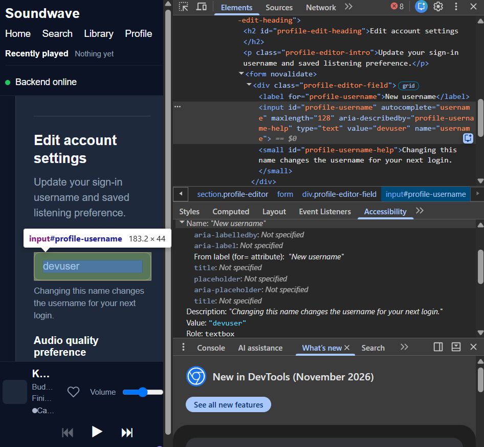
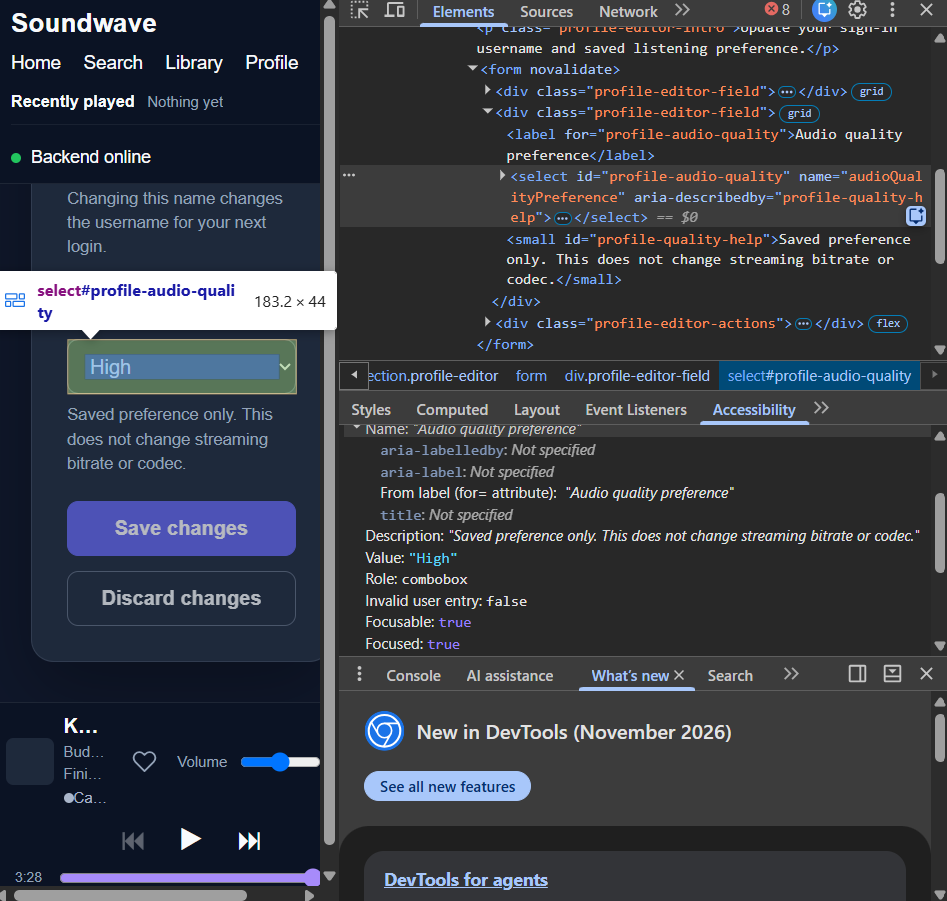
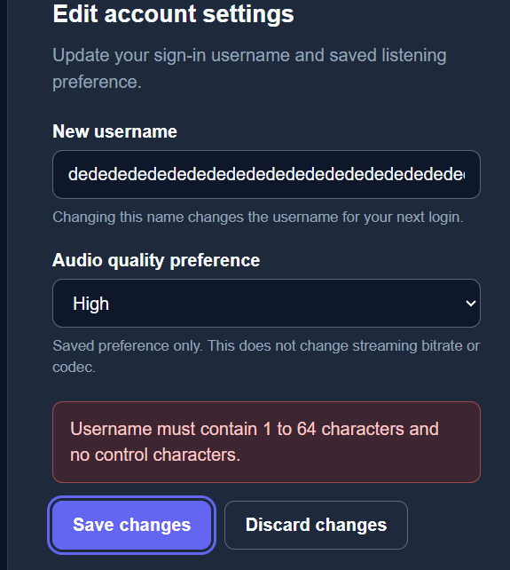
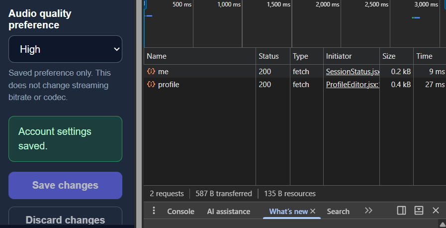
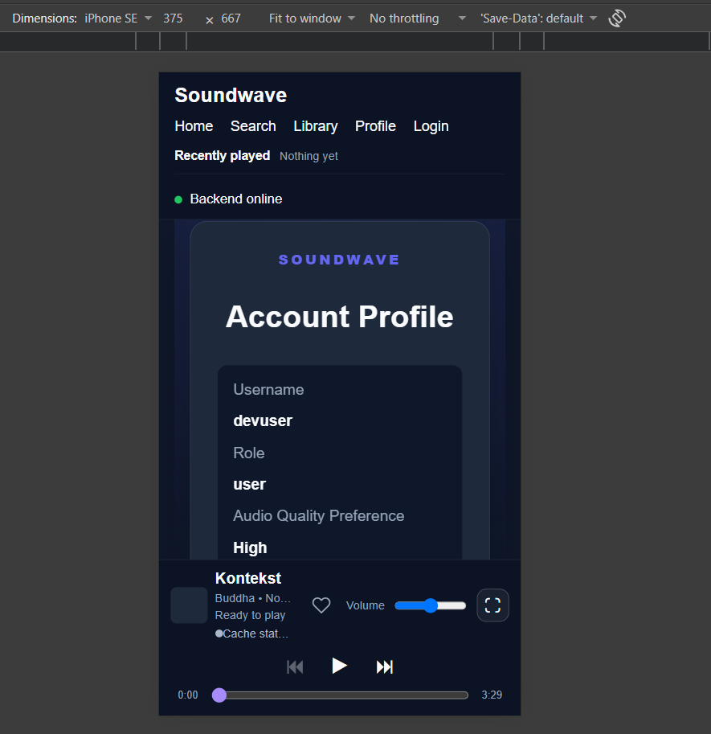

# SCRUM-224 — Sprint 5 Account Settings Exploratory Accessibility Review

- **Owner:** Christian McGowan
- **Jira:** SCRUM-224
- **Status:** Five scoped manual observations completed; current-commit automated checks and peer review pending
- **Scope:** Existing authenticated Soundwave `/profile` editor only (username and audio-quality preference).
- **Method:** Reported keyboard walkthrough, Chrome computed accessibility semantics, visible error/save-state inspection, and mobile viewport review. Spoken screen-reader announcements were not tested.
- **Separation of responsibility:** This is a manual, independent UI review. SCRUM-223 owns the security and invalid-input matrix; SCRUM-243 owns CI smoke. Do not claim either is accomplished here.

## 1. Review setup and provenance

| Field | Record actual value |
|---|---|
| Date, time, timezone | November 19, 2026; Pacific Time (exact browser-observation time not recorded) |
| Git SHA (`git rev-parse --short HEAD`) | `699828c` was the last confirmed synchronized baseline; reverify current SHA prior to PR |
| Branch (`git branch --show-current`) | `christian-dev` (last confirmed) |
| Browser/version | Google Chrome / Chromium DevTools; exact browser version not recorded |
| OS | Windows browser; Ubuntu under WSL used for Soundwave backend and PostgreSQL tooling |
| Desktop viewport, CSS pixels | Desktop browser checked; exact dimensions not recorded |
| Narrow viewport, CSS pixels | 375 x 667 CSS pixels (Chrome mobile emulation); additional docked DevTools narrow view |
| Browser zoom values | Not explicitly recorded; 200% and 400% zoom not tested |
| Assistive technology and version | Screen-reader spoken output NOT TESTED; Chrome DevTools computed Accessibility pane inspected |
| Test account | Local standard `devuser` fixture, as displayed in screenshots; no passwords, tokens, or IDs recorded |
| Test server and database | `http://localhost:5173/profile` with backend at localhost:8080; local development database `soundwave_allison_dev` |
| Evidence folder | Browser screenshots supplied in the working discussion. Save under an approved private evidence location or attach to SCRUM-224; do not claim they are committed to this repository. |

### Preconditions and privacy

- The previously verified local `christian-dev` branch was fast-forwarded to merged PR #182 at `699828c` before the review protocol was installed. Fetch and verify the latest `origin/main` again before committing this completed report. Do not create a new branch or force-push.
- Confirm the app is running at `http://localhost:5173/profile` and the backend is online. Authenticate with an authorized local test account.
- Use test identities and nonsecret usernames. Avoid screenshots of passwords, Authorization headers, JWTs, connection strings, DevTools request bodies, or personal account information.
- Keep `GET /account/profile`, `PATCH /account/profile`, and the existing Account Settings form in place. Do not alter production code merely to make a manual check appear to pass.
- For each of the five named observations below, enter **PASS**, **FAIL**, **BLOCKED**, or **NOT TESTED**; record *actual* behavior, viewport, browser, evidence reference, and defect/Jira link where applicable. A source-code feature alone is not evidence of real-browser success.

## 2. Manual observation matrix (five required observations)

### A11Y-01 — Keyboard focus, navigation, and operability

**References:** WCAG 2.2 2.1.1 Keyboard (A), 2.4.3 Focus Order (A), 2.4.7 Focus Visible (AA), 2.4.11 Focus Not Obscured (Minimum) (AA).

**Procedure:** Start at `/profile` with hands off the mouse. Use `Tab` and `Shift+Tab` through the shell navigation, username input, audio-quality native select, Save, and Discard. Edit username by keyboard, operate the select using native keyboard commands, then activate Discard using `Enter` or `Space`. Make a valid change and submit with keyboard alone. Tab into controls while the sticky playback bar is visible.

**Expected:** All editor controls can be reached and operated without a pointer or keyboard trap; navigation is logical; a clearly visible focus indicator accompanies each focused control; sticky playback UI does not completely obscure the focused element. Inactive controls should not unexpectedly receive keyboard focus.

- Result: **PASS — user-reported keyboard walkthrough within the reviewed Account Settings scope**.
- Browser + viewport + zoom: Chrome desktop and narrow docked DevTools view; exact viewport/zoom for this walkthrough not recorded.
- Actual result and exact steps: User reported keyboard-navigation check completed. In the separate validation screenshot, Save changes visibly retains a purple keyboard-focus outline while an error is displayed. A complete keystroke-by-keystroke focus-order transcript and screen-reader interaction were not recorded; do not claim those extra checks were verified.
- Evidence: CM-S5-B6-A (manual focus observation); visible Save button focus in CM-S5-B6-C.
- Severity / owner / follow-up Jira if failed: No blocking issue reported in observed scope; no defect opened.

### A11Y-02 — Names, labels, instructions, and assistive-technology output

**References:** WCAG 2.2 1.3.1 Info and Relationships (A), 3.3.2 Labels or Instructions (A), 4.1.2 Name, Role, Value (A).

**Procedure:** Click each visible `<label>` (or focus by keyboard), verify that the corresponding username textbox or audio-quality select receives focus. In Chrome DevTools > Elements > Accessibility, inspect the computed accessible name/role for username, quality selector, Save changes, and Discard changes. If available, repeat with NVDA + Chrome and record what is announced for labels and helper text.

**Expected:** Controls have distinct understandable names and correct native roles, and helper information is associated with its corresponding control. Audio-quality guidance must explain that it is saved metadata, not bitrate/codec control. The heading should identify the editor as a logical section.

- Result: **PASS — browser-computed name/role/description verified for both editable fields**.
- Browser + viewport + AT/version: Chrome DevTools Elements > Accessibility, docked narrow viewport; spoken screen-reader output NOT TESTED.
- Actual result: `input#profile-username` exposes accessible name **New username**, role **textbox**, value of current test account, and description **Changing this name changes the username for your next login.** `select#profile-audio-quality` exposes name **Audio quality preference**, role **combobox**, value **High**, focusable state, and description **Saved preference only. This does not change streaming bitrate or codec.** These names derive from associated native labels; descriptions derive from `aria-describedby`. Save/Discard accessible-name inspection and actual NVDA announcement were not separately recorded.
- Evidence: CM-S5-B6-B1 (username computed semantics) and CM-S5-B6-B2 (audio-quality computed semantics).



*Figure CM-S5-B6-B1 — Username input accessible name, role and associated instructions.*



*Figure CM-S5-B6-B2 — Audio-quality selector accessible name, role and associated instructions.*

- Severity / owner / follow-up Jira if failed: No defect observed within these two field semantics; no defect opened.

### A11Y-03 — Validation error identification and announcements

**References:** WCAG 2.2 3.3.1 Error Identification (A), 3.3.3 Error Suggestion (AA), 4.1.3 Status Messages (AA).

**Procedure:** Enter an invalid username such as 65 `a` characters (avoid real account names); use keyboard to Save. Then, if a disposable duplicate username exists, submit it and check the conflict message. Watch where keyboard focus remains and whether the message is in the visible viewport; use NVDA if available to listen for an announcement. Verify error text is specific enough to identify the offending field and suggest correction. Refresh to confirm a rejected save did not change the profile.

**Expected:** The error is readable text, clear about the username or field involved, distinguishable without relying on red color alone, and discoverable/announced to assistive technology. The error must not be covered by the fixed playback bar. Do not claim a successful live announcement without testing it with assistive technology.

**Source-review note, not a failure finding:** The inspected SCRUM-359 implementation uses `role="alert"` for errors and `aria-describedby` for *help* text; its username field does not automatically add `aria-invalid` or a direct error-description reference. Verify actual behavior before assigning severity or opening a remediation task.

- Result: **PASS — visible error identification and keyboard-focus visibility verified**.
- Browser + viewport + AT/version: Chrome browser, responsive/narrow application view; exact CSS dimensions for this screenshot not recorded. Screen-reader announcements NOT TESTED.
- Actual result: After an overlength username was submitted, the editor displayed the specific error **Username must contain 1 to 64 characters and no control characters.** The Save changes button showed a distinct purple focus outline. Error text remained readable and visible above the playback bar. This is evidence of visual error identification; it does not independently prove AT announcements, refresh persistence after rejection, or specific network status.
- Evidence: CM-S5-B6-C (overlength username, error text, Save button focus).



*Figure CM-S5-B6-C — Username validation error and visible Save-button focus.*

- Severity / owner / follow-up Jira if failed: No visual error-feedback defect observed; no defect opened.

### A11Y-04 — Save state, success feedback, and safe recovery

**References:** WCAG 2.2 4.1.3 Status Messages (AA), 3.3.1 Error Identification (A), 2.1.1 Keyboard (A).

**Procedure:** Make a safe preference-only change (e.g., Auto -> High) with a local test account. Activate Save via keyboard. If needed, use DevTools Network throttling to make the request observable; restore normal conditions afterward. Observe the temporary Saving changes... label and disabled controls; verify success status appears and is announced with assistive technology if available. Refresh to confirm persisted value. Next, use Discard to revert an unsaved change; simulate a network error using DevTools offline mode if safe and verify recovery, then restore online mode. Do not change a real user's login name for this test.

**Expected:** Users cannot accidentally double-submit while saving; success and failure have understandable text feedback; the form can recover after failures; Discard restores the current saved values; no success is claimed before server confirmation. Save-state changes remain perceivable without depending exclusively on visual color.

- Result: **PASS — successful save feedback verified for the observed preference update**.
- Browser + viewport + AT/version: Chrome with DevTools Network panel in narrow layout; screen-reader announcements NOT TESTED.
- Actual result: Audio-quality preference displayed **High**, a green status message read **Account settings saved.**, and the Network panel showed a successful `profile` request with HTTP **200**. Save changes was disabled after the value was saved, consistent with there being no unsaved changes. The screenshot does not separately establish the transient `Saving changes...` state, rapid double-submit prevention, recovery from offline errors, or Discard behavior; these remain untested subprocedures.
- Evidence: CM-S5-B6-D (saved High preference and network status 200).



*Figure CM-S5-B6-D — Successful preference save: confirmation and HTTP 200.*

- Severity / owner / follow-up Jira if failed: No observed successful-save feedback defect; no defect opened.

### A11Y-05 — Narrow layout, zoom, readability, and fixed-player usability

**References:** WCAG 2.2 1.4.10 Reflow (AA), 1.4.4 Resize Text (AA), 2.4.11 Focus Not Obscured (Minimum) (AA), 2.5.8 Target Size (Minimum) (AA).

**Procedure:** Test `/profile` at a desktop viewport, then at 375x667 CSS pixels and 320 CSS pixels wide using DevTools device toolbar. Also test browser zoom at 200% and, if feasible, an equivalent 320-CSS-pixel layout at 400%. Scroll to the bottom of the editor and focus each input, select, and button with keyboard. Look for horizontal scrolling, clipped labels, cropped errors, and content hidden under the fixed audio playback bar. Capture viewport sizes accurately.

**Expected:** Username, audio-quality select, help text, Save, Discard, and feedback remain readable and operable. Scrolling vertically should expose the whole editor; keyboard focus must not be completely obscured by the fixed player. No two-dimensional scrolling should be required for ordinary form content at 320 CSS pixels. Note any contrast or touch-target concerns for further measurement.

- Result: **PASS — visual responsive review at the observed mobile size**.
- Browser + viewport + zoom: Chrome device emulation at **375 x 667 CSS pixels**. 320-pixel reflow and 200%/400% zoom were not measured.
- Actual result: The mobile screenshot shows vertically stacked navigation, account summary, and bottom player. Text remains readable and the profile remains presented within the narrow layout. The user additionally reported the mobile interface as visually usable. There is no direct measurement of full-page horizontal overflow or 320-pixel WCAG reflow, nor independent verification of every control's focus visibility when scrolled beneath the fixed playback bar; do not state full WCAG 1.4.10 or 2.4.11 conformance.
- Evidence: CM-S5-B6-E (375 x 667 mobile viewport); narrower DevTools views in CM-S5-B6-B2 and CM-S5-B6-D show action controls.



*Figure CM-S5-B6-E — Account Profile at 375 × 667 CSS pixels.*

- Severity / owner / follow-up Jira if failed: No blocking visual issue reported at the observed viewport; further zoom/reflow checks are a follow-up recommendation, not a confirmed defect.

## 3. Findings and defect triage

Create one line per finding; do not invent failures or label untested behavior as PASS. If all observations pass, explicitly say no defects *observed in this limited manual session*, not that Soundwave is universally WCAG compliant.

| Finding | Observation | Expected versus observed | Severity | Owner | Follow-up Jira | Evidence | Retest result |
|---|---|---|---|---|---|---|---|
| No confirmed defect within the observed test scope | A11Y-01–05 | Five scoped observations reported PASS; deeper assistive-technology, zoom/reflow, and error-recovery procedures not completed | — | — | — | CM-S5-B6-A–E | No remediation/retest required for confirmed defects |

**Severity rubric:** Critical = account controls unusable by keyboard or sensitive data exposed; High = essential save/error/focus path inaccessible; Medium = discoverability, labeling, overlay, or reflow issue with workaround; Low = minor presentation concern without task blockage. Use actual impact and team priority conventions when filing defects.

If a defect is found, note steps to reproduce, browser/viewport, expected/actual, responsible component, severity, screenshot, and the linked Jira issue. Do not silently change teammate-owned navigation or media-player code; coordinate ownership first. For changes to the Christian-owned editor, create a separate focused remediation PR or clearly document a reviewed adjustment.

## 4. Evidence and verification summary

| Evidence ID | Subject | File or reference | Status |
|---|---|---|---|
| CM-S5-B6-A | Keyboard focus and navigation | Manual walkthrough reported; visible Save focus also appears in CM-S5-B6-C | Reported; dedicated keyboard traversal screenshot recommended |
| CM-S5-B6-B | Field labels, roles, and hints | Embedded Figures CM-S5-B6-B1 and CM-S5-B6-B2; original PNGs under `docs/evidence/scrum224/` | Included; computed field semantics verified |
| CM-S5-B6-C | Validation error feedback | Embedded Figure CM-S5-B6-C; original PNG bundled | Included; visible error and Save focus verified |
| CM-S5-B6-D | Save, status, and recovery | Embedded Figure CM-S5-B6-D; original PNG bundled | Included; successful save only; failure/recovery not tested |
| CM-S5-B6-E | Narrow layout and fixed player | Embedded Figure CM-S5-B6-E; original PNG bundled | Included; visual review only; zoom/320px not tested |
| CM-S5-B6-F (optional) | Screen reader announcement transcript | No NVDA or other spoken announcement transcript supplied | NOT TESTED |

After running tests on the **current** commit, add their actual command and results here; previous sprint totals are historical baselines only:

```bash
cd ~/Soundwave-Live-Version
printf 'Commit: '; git rev-parse --short HEAD
printf 'Branch: '; git branch --show-current
cd client
npm run test:run -- src/pages/Profile.test.jsx src/pages/ProfileEditor.test.jsx
npm run lint
npm run build
```

- Current-commit test result: **PASS — 18 tests passed across 2 test files; exit code 0.**
- Current-commit lint result: **PASS — npm run lint; exit code 0.**
- Current-commit build result: **PASS — npm run build; exit code 0.**
- Manual observations: **5/5 scoped observations recorded PASS**, with explicit subprocedure limits above
- Confirmed accessibility defects: **None observed in the tested scope**; not a conformance certification
- Follow-up Jira issue(s): **None opened from these observations**; consider later NVDA, zoom, and 320-pixel checks
- Reviewer / date / outcome: Pending peer reviewer sign-off; observations collected November 19, 2026

## 5. Acceptance and handoff checklist

- [x] A11Y-01 Keyboard focus documented from user report and focus screenshot (complete traversal screenshot not separately captured).
- [x] A11Y-02 Labels and programmatic names documented with Chrome Accessibility screenshots.
- [x] A11Y-03 Visual error feedback documented with a screenshot; spoken announcement not tested.
- [x] A11Y-04 Successful save/status documented with screenshot; transient saving and failure recovery not tested.
- [x] A11Y-05 Visual usability at 375 x 667 documented with screenshot; 320px and zoom not tested.
- [x] Each observation records its scoped result, available browser/viewport context, expected vs. observed behavior, and evidence or evidence gap.
- [x] No defects were confirmed in this limited review; untested subprocedures are identified for follow-up.
- [x] The report includes no passwords, tokens, connection strings, or account IDs. Verify each externally attached screenshot independently before upload.
- [ ] Peer review and Jira/PR linking pending.

## 6. Source references and scope notes

- Internal plan: `Christian_McGowan_S3-S6_Test_Plan_Reconciled.docx`, Sprint 5 `CM-T52` (now Jira `SCRUM-224`): five named observations, dated browser evidence, severity/owner/follow-up, nonoverlap with teammates.
- Merged frontend implementation: SCRUM-359 / PR #174 (`client/src/pages/ProfileEditor.jsx`, `client/src/styles/profile-editor.css`); validate its *current* contents after synchronizing.
- WCAG 2.2: https://www.w3.org/TR/WCAG22/
- W3C Keyboard SC 2.1.1: https://www.w3.org/WAI/WCAG22/Understanding/keyboard
- W3C Error Identification SC 3.3.1: https://www.w3.org/WAI/WCAG22/Understanding/error-identification
- W3C Status Messages SC 4.1.3: https://www.w3.org/WAI/WCAG22/Understanding/status-messages
- W3C Focus Not Obscured SC 2.4.11: https://www.w3.org/WAI/WCAG22/Understanding/focus-not-obscured-minimum
- W3C Reflow SC 1.4.10: https://www.w3.org/WAI/WCAG22/Understanding/reflow

**Scope caveat:** This is a focused exploratory review, not a formal WCAG conformance certification, a full screen-reader audit, an automated axe scan, a penetration test, or a CI workflow. The final report must distinguish observed results from not-tested scenarios.

## 7. Completion notes and residual test coverage

Five scoped observations were completed/reported during the November 19 manual session, with the evidence distinctions above. This assessment is a targeted visual and Chrome accessibility-tree review, **not** a complete WCAG conformance statement or a successful screen-reader audit. The pending subprocedures are: full keyboard traversal evidence for A11Y-01, Save/Discard accessible names and NVDA speech for A11Y-02, live alert speech for A11Y-03, transient saving/offline recovery for A11Y-04, and 320-pixel/200% zoom/horizontal-overflow measurement for A11Y-05. These limits do not negate the observed passes, but should not be silently reported as verified.

**Environment note:** During this review, the backend reported PostgreSQL error `42P01` because the local `playback_events` table was missing. Running the repository's standard migration runner applied `20261029_mchoi_001_playback_events.sql` to the authorized local development database `soundwave_allison_dev`, and a subsequent read-only query verified that the table exists. This was an environment/schema synchronization issue affecting playback-event logging, not an Account Settings accessibility defect. A separate successful post-migration event write was not supplied; the observation belongs to SCRUM-360 integration notes and not to this report's accessibility acceptance.


## 8. Screenshot evidence included with this report

The five Account Settings screenshots are embedded above using repository-relative links. The original PNGs extracted from the user-supplied Word document are included at `docs/evidence/scrum224/` in this package. They depict computed username semantics (B1), computed quality semantics (B2), username validation and keyboard focus (C), successful preference save (D), and visual mobile layout (E). The full keyboard-traversal observation (A) was user-reported; no separate full navigation-sequence screenshot was supplied.

An additional image of the Login page's focused button was deliberately omitted because it is **not** evidence of Account Settings keyboard accessibility. The five scoped observations are reported as passing only for their explicitly documented checks; spoken screen-reader announcements, comprehensive zoom/reflow measurements, and offline save recovery are not claimed.

**Verification baseline:** `699828c`; November 19, 2026.
Manual accessibility results and screenshot evidence are recorded in the preceding sections.

## Post-integration verification

**Verification date:** November 19, 2026
**Integrated Git commit:** `49f84b6`
**Integration reference:** GitHub PR #184

After synchronizing `christian-dev` with the latest merged
team changes, the following checks were executed:

- Account Settings focused tests: PASS, 18/18 tests.
- Profile test files: PASS, 2/2 files.
- ESLint: PASS, exit code 0.
- Vite production build: PASS, exit code 0.
- Accessibility screenshot evidence: five PNG files.
- Markdown screenshot references: five verified valid paths.

The five scoped manual accessibility observations remain
documented in this assessment. This does not constitute
comprehensive WCAG certification.

GitHub Actions and peer review must be verified separately.
