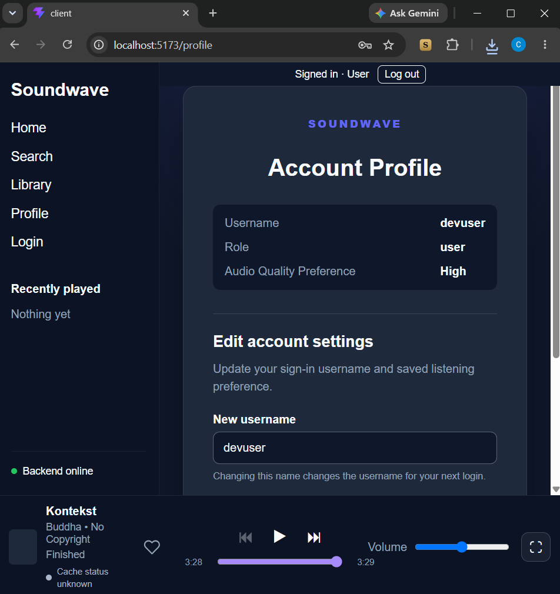
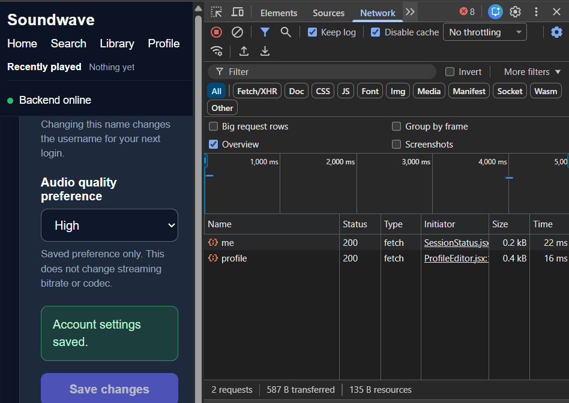
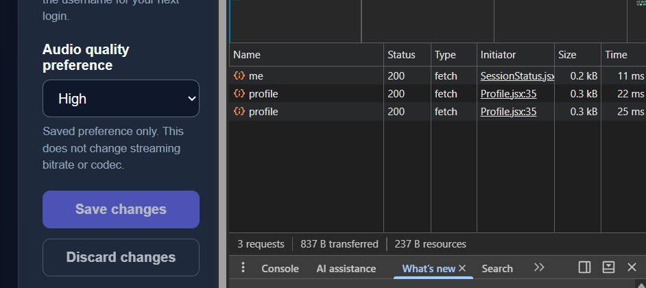
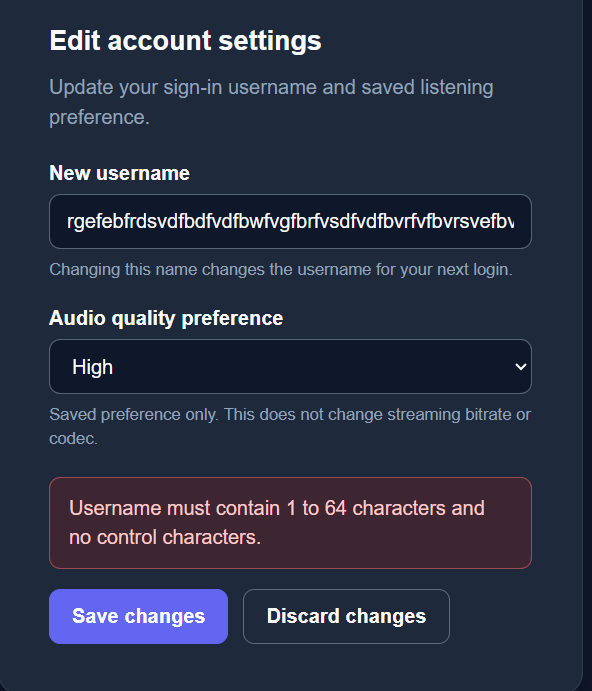
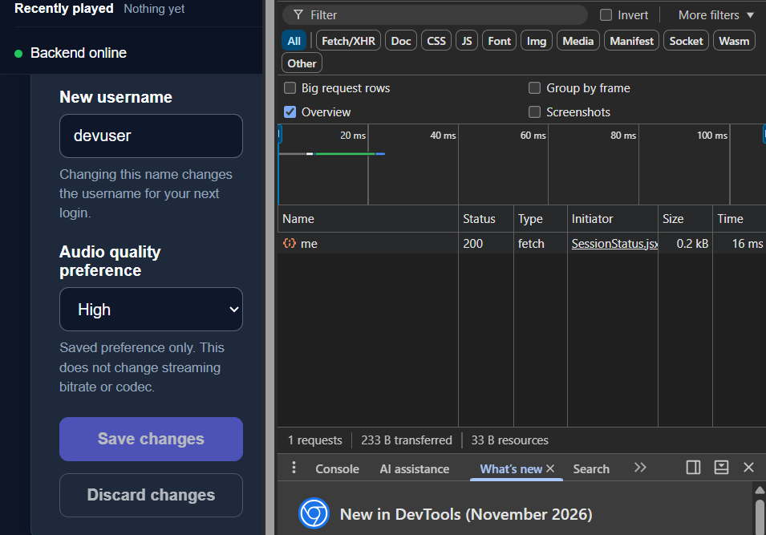
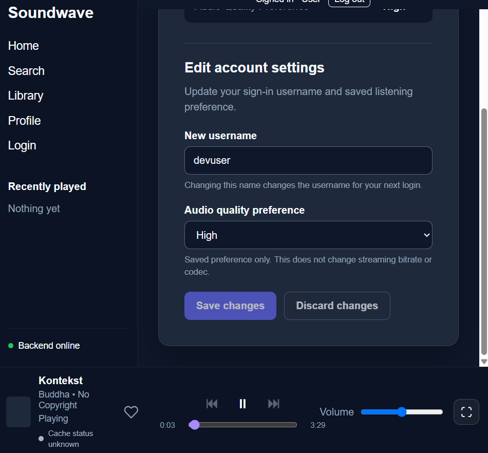

# SCRUM-360 — Sprint 5 Integrated Regression and Individual Demo Dry-Run

- **Owner:** Christian McGowan
- **Project:** Soundwave / CPSC 491-05 / Sprint 5
- **Issue:** SCRUM-360
- **Observation date:** November 19, 2026 (America/Los_Angeles)
- **Tested commit:** `181fcb0` — merge PR #187, Account Settings CI workflow
- **Branch:** `christian-dev`, fast-forward synchronized with `origin/main` (`0 0` at observation time)
- **Status:** Automated integration regression PASS; six scoped individual browser dry-run scenarios observed/reported PASS on November 19, 2026. All six embedded PDF screenshots extracted and packaged; repository installation and reviewed PR sign-off remain pending.

## 1. Purpose and ownership boundary

Independently verify that the integrated Sprint 5 Soundwave code retains healthy server/client regressions and can support Christian's own Account Settings demonstration. This task is a **cross-component regression and individual demo record**, not a duplicate of Emmanuel's canonical login/search/play journey, Matthew's streaming byte-range/media-protocol testing, Allison's favorites database-isolation or migration oracles, Konner's queue/navigation or deployment acceptance, or SCRUM-243's dedicated PostgreSQL/HTTP CI smoke. Teammate-authored features are observed only as dependencies of the integrated application.

## 2. Automated regression execution — confirmed results

All commands ran locally from `~/Soundwave-Live-Version` after the branch was synchronized to `181fcb0`. Exit codes and terminal summaries were supplied during the November 19 session.

| ID | Exact command (from repository root) | Expected | Observed | Result |
| --- | --- | --- | --- | --- |
| REG-01 | `( cd server && npm test )` | All Node backend tests pass, no failures | **315 passed, 0 failed**, 12 suites; exit code **0**; duration **7.03 s** | **PASS** |
| REG-02 | `( cd client && npm run test:run -- --no-file-parallelism )` | All client files and tests pass with file-level parallelism disabled | **48/48 files; 267/267 tests**, exit code **0**; duration **74.31 s** | **PASS** |
| REG-03 | `( cd client && npm run test:run )` | All client files and tests pass in default parallel mode | **48/48 files; 267/267 tests**, exit code **0**; duration **22.93 s** | **PASS** |

**Totals:** 849 successful test executions across three invocations, representing 315 server test cases and 267 client test cases exercised twice (sequentially and in parallel). The repeated client runs must not be described as 534 independent client test cases.

**Local log paths (not committed):**

- `/tmp/soundwave-scrum360/server.log`
- `/tmp/soundwave-scrum360/client-sequential.log`
- `/tmp/soundwave-scrum360/client-parallel.log`

**Timing evidence:** sequential client run started at 15:31:06 local time; default parallel run started at 15:32:20 local time. The source's exact browser version and CI run ID were not supplied for this regression session. GitHub PR #187 is merged; the user reported its newly added workflow ran properly, but this report does **not** substitute for its actual GitHub Actions job URL and conclusion.

### Historical parallel-test risk — not reproduced in this run

Earlier integrated runs exhibited intermittent favorites/playback-related failures in default parallel execution, while sequential execution passed. On commit `181fcb0`, **one** observed default parallel run passed all 267 tests. This demonstrates a green run on the tested revision; it does **not** establish that the intermittent failure has been fixed or that repeated parallel runs are stable. Do not make unrelated changes to teammate-owned tests merely to produce a green result. If the intermittent failure recurs, capture the failing test names, full output, revision, repetition count, and accountable component owner in a separate issue/triage record.

## 3. Individual Account Settings browser dry-run — completed observation record

**Session:** November 19, 2026, approximately 15:40 Pacific Time (precise individual screenshot timestamps not captured). **Browser:** Google Chrome on Windows (exact version not recorded). **Frontend URL:** `http://localhost:5173/profile`. **Backend:** Online, as indicated by the UI and observed successful `me`/`profile` requests. **Authorized local account:** standard test fixture `devuser`; role `user`. **Git revision:** `181fcb0` was the most recent synchronized and tested revision; the screenshot content itself does not expose a Git SHA, so provenance is based on the accompanying terminal run. **Audio quality:** saved metadata preference `High`, not proof of changed codec or stream bitrate. **Viewport:** desktop and narrower DevTools-docked application views; exact CSS widths of the docked views not independently measured.

The six screenshots supplied for the individual demo were inspected as **visual evidence**. A screenshot demonstrates the visible state; where the action itself cannot be observed in a still image, the operator's report and the visible postcondition are distinguished below.

| ID | Expected / action | Actual observed on November 19 | Scoped result | Evidence |
| --- | --- | --- | --- | --- |
| **DEMO-01** | Sign in and open `/profile`; verify own account summary. | Chrome shows `localhost:5173/profile`, **Signed in · User**, account `devuser`, role `user`, saved audio quality `High`, and backend online. | **PASS — visually verified account state** | **CM-S5-B8-D1**, authenticated profile and shell |
| **DEMO-02** | Edit quality preference, Save; observe success and server response. | The form displays `High`, green textual confirmation **Account settings saved.**, and a `profile` request with **HTTP 200** in DevTools. The screenshot does not expose the request method or prove codec/bitrate changes. | **PASS — visual save and HTTP-success feedback** | **CM-S5-B8-D2**, save confirmation and Network pane |
| **DEMO-03** | Refresh/reload after save; confirm persisted `High`. | A later Network view shows two successful `profile` reads (**200**) alongside the `High` selector and disabled Save/Discard actions. The user reports this as the post-refresh observation. This is consistent with persisted preference; the still image does not prove a refresh keystroke or inspect a SQL row. | **PASS — reported refresh, visible GET/read state** | **CM-S5-B8-D3**, post-refresh profile reads |
| **DEMO-04** | Submit an overlength username; expect a specific validation error. | The form displays the error **Username must contain 1 to 64 characters and no control characters.** The error is readable, with Save and Discard available for correction. No server-side persistence outcome was separately captured in this screenshot; SCRUM-223 owns database rollback security evidence. | **PASS — visual invalid-input feedback** | **CM-S5-B8-D4**, username error |
| **DEMO-05** | Modify an unsaved form field and Discard; restore last-saved state. | Following the reported Discard action, the form shows `devuser`, saved quality `High`, and disabled Save/Discard controls (no pending changes). The shown Network pane contains an authenticated `me` 200 request, but a still screenshot is not a complete proof that no PATCH was sent. | **PASS — operator-reported Discard with visible final state** | **CM-S5-B8-D5**, restored form |
| **DEMO-06** | Keep Account Settings usable alongside the integrated player. | With the profile editor visible, the bottom bar displays track **Kontekst**, status **Playing**, about **0:03 / 3:29**, playback/seek/volume controls, while the editor fields and action buttons remain accessible above the bar in the scrolled viewport. This is UI coexistence evidence, not validation of media Range responses or continuous audio fidelity. | **PASS — visually verified coexistence** | **CM-S5-B8-D6**, live player and editor |

**Dry-run disposition:** **6/6 scoped demo observations passed**; no blocking Account Settings defect was observed in this session. The screenshots do **not** establish password reauthentication policy, complete server data isolation, screen-reader announcements, absence of all background PATCH requests, or full media-protocol correctness. Those are separate review domains.

### Figure evidence for the individual demo

The six figures below were extracted **directly from the uploaded November 19 PDF's embedded image streams**, without redrawing or fabricating screenshots. These PNGs reflect the PDF's exported image resolution; they may differ from the browser's original full-resolution screenshot files. The PDF pages and PNG filenames are listed in Section 7. Screenshot states are evidence of visible outcomes; reported clicks and refresh actions are not independently captured as video.

**Figure CM-S5-B8-D1 — Authenticated Account Profile and Running Application Shell.** The local test account is signed in on /profile, with username, role, saved audio-quality metadata, and backend-online indicator.

**Figure CM-S5-B8-D2 — Successful Settings Save with Network Confirmation.** A readable save confirmation appears alongside the High preference and an HTTP 200 profile request in DevTools.

**Figure CM-S5-B8-D3 — Post-Refresh Profile Retrieval and Saved Preference.** After the user-reported refresh, subsequent successful profile reads appear alongside the saved High preference and inactive Save/Discard controls.

**Figure CM-S5-B8-D4 — Overlength Username Validation Error.** The form displays the specific 1-64-character username error and permits correction.

**Figure CM-S5-B8-D5 — Discarded Unsaved Change Returns to Saved State.** After the operator-reported Discard action, the editor shows the saved username and preference with no pending changes.

**Figure CM-S5-B8-D6 — Integrated Account Settings with Active Audio Playback.** The Account Settings editor and the persistent player are visible together; the bottom player shows track Kontekst in a Playing state.

## 4. Cross-sprint dependencies and risk ledger

| Item | Evidence and interpretation | Impact / next owner | Current status |
| --- | --- | --- | --- |
| Prior parallel-client flakiness | Earlier failures occurred in favorites/playback tests. Current 267/267 parallel pass on `181fcb0` does not guarantee stable repeated execution. | Document/retest if it recurs; coordinate with owning team component. | **NOT REPRODUCED on this run; historical risk** |
| Local `playback_events` migration | Previous PostgreSQL `42P01` missing-table error was resolved by the repository migration runner; table presence was verified in the local development database. A successful post-migration playback event write was not separately supplied. | Release environment migration/readiness verification belongs in SCRUM-356 / relevant teammate integration scope. | **Schema present; event-write retest not established** |
| Account quality preference | UI saves `Auto`/`Low`/`Medium`/`High` metadata via Account Settings. No evidence that this alters streaming bitrate/codec. | Explain accurately in the demo; avoid claiming adaptive audio implementation. | **Documented contract** |
| Sensitive username change / reauthentication policy | Profile update supports sign-in-name changes, but current policy and reauthentication requirement have not been approved by a security review in this evidence set. | Flag as risk/decision for SCRUM-356, not a confirmed vulnerability. | **Policy review pending** |
| SCRUM-243 isolated CI workflow | PR #187 was merged and its Checks tab later showed 14 checks; user reports it ran properly. An individual workflow-run URL and downloadable artifact were not included in this record. | Attach actual run URL, conclusion, and artifact under SCRUM-243/SCRUM-361. | **Run evidence URL pending** |

No new blocking defect was identified by the **three automated test executions or the six scoped browser dry-run observations**. This does not mean that every product path or every formal acceptance condition was independently verified.

## 5. Evidence required before final SCRUM-360 acceptance

- [x] Server regression command, exit status and test count recorded for `181fcb0`.
- [x] Sequential client command, exit status and test count recorded for `181fcb0`.
- [x] Default parallel client command, exit status and test count recorded for `181fcb0`.
- [x] Earlier parallel flaky-test history and risk distinguished from the current green run.
- [x] Execute and document six scoped individual browser dry-run scenarios; report and visible postconditions distinguished where appropriate.
- [x] Map six supplied screenshots to named scenario captions, with no credentials/tokens exposed in the visible views.
- [x] All six screenshot images extracted from the supplied PDF, verified as PNGs, and included at repository-relative paths in the accompanying ZIP.
- [x] No blocking Account Settings defect observed in the six scoped demo scenarios; historical parallel-test flakiness remains documented as a risk.
- [ ] Record the current approved PR, reviewer and merged commit when the evidence document is reviewed.
- [ ] Confirm any required new-release CI checks on the final review SHA; local success alone is not CI evidence.

## 6. Related traceability

- SCRUM-360 — integrated regression and individual dry-run (this record).
- SCRUM-224 / merged PR #186 — manual Account Settings accessibility evidence and five screenshots (separate acceptance scope).
- SCRUM-223 / merged PR #182 — independent Account Settings authorization and invalid-input matrix (separate acceptance scope).
- SCRUM-243 / merged PR #187 — isolated Account Settings HTTP/PostgreSQL GitHub Actions workflow (separate CI scope).
- SCRUM-356 — release-readiness gap assessment (next risk disposition).
- SCRUM-361 — final Sprint 5 evidence index and submission handoff.

**Disposition:** **AUTOMATED REGRESSION PASS; SIX-SCENARIO MANUAL DRY-RUN PASS (scoped evidence).** The six screenshot assets are packaged; repository installation, PR/peer-review sign-off, and final CI provenance remain outstanding. This is not a blanket release-ready or WCAG conformance assertion.

## 7. Repository screenshot manifest (PDF-extracted PNGs)

| Figure | Source PDF page | Repository file | Evidence status |
| --- | --- | --- | --- |
| **D1** | 5 | `docs/evidence/scrum360/CM-S5-B8-D1-authenticated-profile.png` | **Included, extracted from uploaded PDF** |
| **D2** | 6 | `docs/evidence/scrum360/CM-S5-B8-D2-save-confirmation.png` | **Included, extracted from uploaded PDF** |
| **D3** | 6 | `docs/evidence/scrum360/CM-S5-B8-D3-refresh-persistence.png` | **Included, extracted from uploaded PDF** |
| **D4** | 7 | `docs/evidence/scrum360/CM-S5-B8-D4-username-validation.png` | **Included, extracted from uploaded PDF** |
| **D5** | 8 | `docs/evidence/scrum360/CM-S5-B8-D5-discard-restored.png` | **Included, extracted from uploaded PDF** |
| **D6** | 9 | `docs/evidence/scrum360/CM-S5-B8-D6-playing-with-profile.png` | **Included, extracted from uploaded PDF** |

**Provenance:** All six PNGs were taken from the PDF's embedded image objects, not generated from a description or rebuilt as simulated user-interface screenshots. They are traceable to the user-supplied 12-page PDF. Their dimensions reflect the PDF export; larger original browser PNGs are optional if higher-resolution reproduction is needed. Each figure is embedded above through a relative Markdown image link.

**Remaining verification gates:** Install these repository files on `christian-dev`, review the source diff, complete peer-reviewed GitHub PR, and record the actual CI run URL/commit/conclusion separately. None of those future actions is claimed complete by this package.
